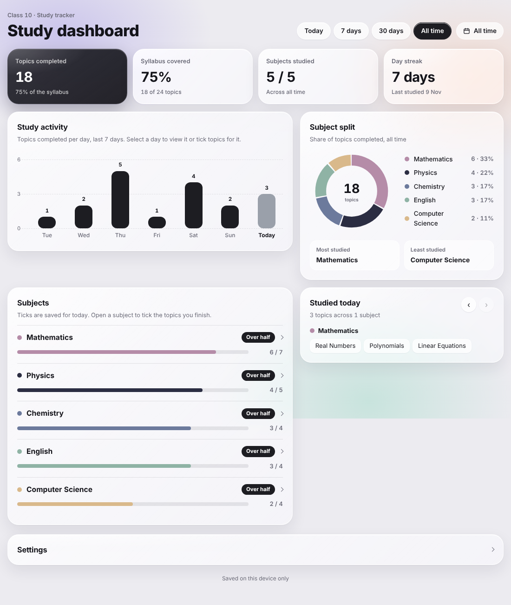
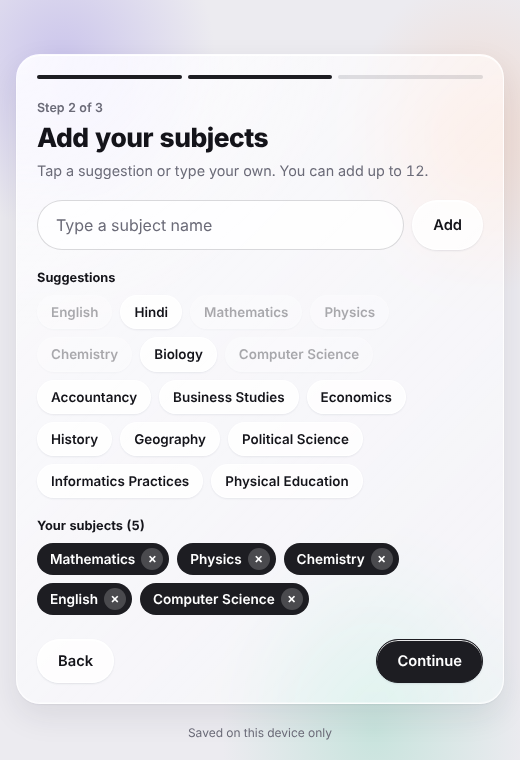

# Study Tracker

A simple, clean study tracker that works for any class, subject list and syllabus. You tell it your class, your subjects and your chapters. Then you tick topics as you finish them and watch your progress fill up.

**Live demo:** https://udit0665.github.io/tracker/

## What it does

- **Setup in three steps:** your class or course, your subjects, then your chapters for each subject. Nothing is preset, so it fits any board, school or college.
- **Welcome flow:** first-time users see a short welcome screen before building their tracker.
- **Progress per subject:** every subject has its own progress bar that fills as you tick chapters.
- **Daily log:** see what you studied today (or any earlier day) and which topics you covered.
- **Study activity:** a bar chart of topics completed over the last 7 days.
- **Subject split:** a donut chart that shows which subjects get the most and least of your time.
- **Stats:** topics completed, syllabus covered, subjects studied and your day streak, with Today, 7 days, 30 days and All time views.
- **App-style navigation:** Home, Activity, Today and Settings are separated into bottom tabs on the dashboard.
- **System theme support:** the website automatically follows the device's light or dark mode without changing the brand palette.
- **Settings:** rename your class or course, add, rename or remove subjects, export/import a portable backup, and start over at any time.
- **Installable:** works as a home screen app on a phone and keeps working offline after the first visit.

## How to use it

1. Open the page and enter your class (for example Class 10, Grade 12 or B.Com Year 1).
2. Add your subjects. Tap a suggestion or type your own.
3. Paste or type your chapters for each subject, one per line. You can skip this and add chapters later.
4. Open a subject and tick each topic when you finish it. Use the arrows in "Studied today" to log a day you missed.

Your data is saved in your browser on your own device. It is not sent anywhere and it does not sync between devices. Use **Settings → Export backup** if you want to move the tracker to another browser or device.

## Run it yourself

There is no build step and nothing to install.

- Open `index.html` in a browser, or
- serve the folder with any static server, for example `python3 -m http.server`, then open `http://localhost:8000`.

## Put it on GitHub Pages

1. Create a repository and upload all the files from this folder to the main branch.
2. Go to **Settings > Pages**, choose **Deploy from a branch**, pick `main` and the `/ (root)` folder, and save.
3. After a minute your site is live at `https://<your-username>.github.io/<repository-name>/`.

## Install on a phone

Open the live page in Chrome on Android, tap the menu (three dots), then **Install app** or **Add to Home screen**.

## Files

| File | Purpose |
| --- | --- |
| `index.html` | The whole app: markup, styles and script in one file |
| `manifest.webmanifest` | Name, colours and icons for installing the app |
| `sw.js` | Service worker that caches the app for offline use |
| `icon-*.png`, `apple-touch-icon.png`, `favicon.png` | App icons |

## Built with

Plain HTML, CSS and JavaScript. No framework and no dependencies, apart from the Manrope font loaded from Google Fonts. Charts are drawn with SVG and the data is stored in `localStorage`.

## Ideas for later

- Export and import your progress as a file, so you can move it between devices
- Exam date countdown
- Mock test score tracker
- Dark mode
